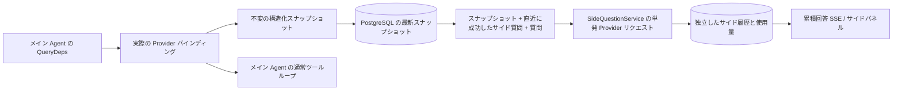

# ARTEX `/btw`

通常のチャット、タスクの MainAgent、および現在のタスク自身の Worker は、独立したサイドクエスチョンをサポートします。メイン入力欄に `/btw 質問` と入力して送信でき、空の `/btw` または「サイドクエスチョン」ボタンで履歴を開きます。デスクトップでは幅を調整できるサイドバー、モバイルでは Drawer を使用します。

サイドクエスチョンの回答は、送信時点の Agent コンテキストのスナップショットに基づいて生成され、ストリーミング表示、追加質問、停止、クリアをサポートします。パネルを閉じる、ページを更新する、SSE を切断するといった操作では、モデルへのリクエストはキャンセルされません。停止は現在のサイドクエスチョンのみに影響し、クリアはサイドクエスチョンをキャンセルしてサイドクエスチョン履歴を削除しますが、メインコンテキストのスナップショットは保持します。

## 実装の境界

Go、norma v0.3.7、Next.js、および既存の Markdown / ResizablePanel / Drawer / AlertDialog コンポーネントをそのまま使用しています。norma のソースコードは変更せず、サイドクエスチョンのために依存関係を追加してもいません。Planner、他のタスクから継承した Worker、ツール型サブタスクの昇格は今回の対象外です。

- `capture.go` は `Options.Deps.CallModel / CallModelSync` の呼び出しを主ループのリクエストとしてのみマークします。Provider デコレータは具体的なモデルの内部、ルーティングプールの外側での選択より後に位置するため、実際に選択されたモデルを記録します。圧縮リクエストと要約リクエストはスナップショットを上書きしません。
- リクエストの開始時、モデルからの完全な応答時、実行の終了状態時にスナップショットを発行します。生成途中の半端な応答は発行しません。ツール呼び出しは norma の `MessagesForAPI` を通じてペアを維持し、ツール結果は次回のメインモデルリクエスト時または実行の終了状態時にスナップショットへ入ります。ストリーミングが中断された場合は、直前の有効な境界が保持されます。
- スナップショットは JSON のディープコピーによって、構造化メッセージ、システムプロンプト、ツール定義、および生成パラメータを保持します。モデルの推論中はスナップショットのロックやデータベーストランザクションを保持しません。
- `SideQuestionService` は具体的な Provider を呼び出します。必要に応じて先にサイドクエスチョンの要約を生成し、最終回答はコンテキストが初めて上限を超え、かつまだテキスト／ツール呼び出しを出力していない場合に限り、縮小して 1 回だけ再試行できます。agent session は作成せず、ツール実行エンジン、メインの transcript、アクティビティストリーム、タスクグラフにも接続せず、タスクのモデル切り替えチェーンも経由しません。回答にツール定義を残すのは、既存の構造化ツールコンテキストとの互換性のためです。要約リクエストにはツールを提供しません。新たに返されたツール呼び出しには実行経路がありません。
- 親セッションごとに 1 つの実行中リクエストを許容し、1 つのサービスプロセスで最大 4 つ、1 回のタイムアウトは 120 秒です。サイドクエスチョンはサービスライフサイクルの下にある独立したキャンセルコンテキストを使用します。
- サイドクエスチョンのリクエストはモデル設定への参照と非機密の識別情報の要約を保持し、リクエスト時に既存の設定から認証情報を取得します。設定が削除された場合、またはモデル・プロトコル・アドレスなどの識別フィールドが変更された場合は、先にメイン Agent を実行してスナップショットを更新する必要があります。テストによって製品のデフォルトモデルが変更されることはありません。

## 永続化と復元

`db/schema.sql` は `side_question_sessions` と `side_question_requests` を自動的に作成します。前者は親リソース、最新スナップショット、実行番号、バージョン、クリアバージョンを保持し、後者は質問、累積回答、ステータス、モデル、スナップショット時刻、使用量、イベント連番、ページング連番を保持します。

親セッションのキーには conversation ID、または task ID + exploration ID + intent ID を使用します。Worker は再利用可能な実行スロットの命名を使用しません。

スナップショットは親セッション単位でマージして書き込み、250 ms ごとに更新します。データベースは `(run_id, version)` を比較して古いバージョンによる上書きを防ぎます。サイドクエスチョンの送信前に、選択されたスナップショットを改めて保存します。保存に成功するとメモリ上の大きなスナップショットを解放し、失敗した場合は書き込み待ちのバージョンを保持します。回答の累積内容は、ストリーミングイベントの到着時に最大 250 ms ごとに 1 回書き込み、終了状態では即座に保存し、データベースエラー時には限定的に再試行します。

サービスの起動時に、残留している `running` リクエストを `interrupted` としてマークし、すでにデータベースへ書き込まれた部分的な回答と使用量は保持しますが、リクエストを自動的に再実行することはありません。最後に正常に保存されたコンテキストは、次の質問にそのまま使用できます。スナップショットを持たない古いセッションでは、先にメイン Agent を実行する必要があり、UI のアクティビティ記録からコンテキストを再構築することはしません。

クリア操作はクリアバージョンをインクリメントしてリクエストを削除し、条件付き更新によって遅延して到着したコールバックが書き戻すのを防ぎます。親リソースの物理削除は外部キーのカスケードに依存し、Worker の論理削除は同一トランザクション内でサイドクエスチョンのデータを削除し、その後に到着する遅延スナップショットを拒否します。タスクのアーカイブでは、まず新規リクエストをブロックし、メインフローの停止を待ち、サイドクエスチョンをキャンセルして永続化を待ちます。アーカイブ形式は v3 で、サイドクエスチョンのテーブルを含まない v1/v2 とも互換性があります。

履歴は完全に保存され、連番カーソルにより 1 ページあたり最大 20 件を返します。モデルリクエストでは直近 20 組の成功した質疑応答の原文を最大で再生し、同時に token 予算によって再生量を制限します。より古い質疑応答については独立したローリングサマリーを維持します。メインコンテキストが予算を超えた場合、サイドクエスチョン側のコピーの古い部分のみを要約し、直近の構造化ツール呼び出しとその結果は保持します。要約と準備の進捗は、使用量とあわせてサイドクエスチョンの並行数、キャンセル、120 秒のタイムアウト制限の対象になります。詳細は[コンテキスト予算とオープンソースの参考](context-budget.md)を参照してください。

## HTTP 契約

以下のパスは `{parent}` として扱われ、既存の認証とリソース検証をそのまま使用します：

- `/api/conversations/{id}`
- `/api/tasks/{id}/chat`
- `/api/tasks/{id}/intents/{iid}`

| リクエスト | レスポンスと動作 |
| --- | --- |
| `GET {parent}/side-questions?before={ordinal}` | `items` は新しい順に並び、独立した `current` の実行状態、`snapshot` のメタ情報、`next_cursor` を含みます。カーソルが 0 の場合は最新ページ／次ページなしを意味します |
| `POST {parent}/side-questions` | JSON `{ "question": "…", "client_request_id": "UUID" }`；新規リクエストは 202 とリクエストオブジェクトを返します。同じ ID と同じ質問の場合は既存のオブジェクトを 200 で返します |
| `DELETE {parent}/side-questions` | 現在の親セッションのサイドクエスチョンをキャンセルしてクリアします |
| `GET /api/side-questions/{requestID}/events` | `snapshot` の SSE イベントで、`id` は増加する連番、`data` は累積された完全なリクエストオブジェクトです。クリア時には `cleared` を送信します |
| `POST /api/side-questions/{requestID}/cancel` | 明示的なキャンセルです。終了状態は履歴または SSE から取得できます |

質問の上限は 4000 文字です。スナップショットがない場合、モデル設定が変更された場合、同じ親セッションがビジー状態の場合、または冪等 ID が競合した場合は 409 を返します。グローバルな並行数の上限に達した場合は 429 を返します。SSE 接続では毎回まず累積状態を送信し、クライアントが以前に受信したテキスト断片には依存しません。フロントエンドはリクエスト ID + 連番でマージし、親セッションの切り替え時やクリア時に古いコールバックを破棄します。

## 検証と参考

自動チェック、実際のモデル使用状況、および既知の制限については [validation.md](validation.md) を参照してください。

独立したリクエストの参考として [Grok CLI side-question.ts（固定コミット）](https://github.com/superagent-ai/grok-cli/blob/fb97af83f06dca873281d60168430f06c8de6324/src/utils/side-question.ts)、実行の分離の参考として [OpenCode（固定コミット）](https://github.com/anomalyco/opencode/tree/b3f1a96c6dd7adeb28b36dd11add1998fc84d67b) を挙げます。ARTEX のコンテキストは norma の構造化メッセージを使用しており、フロントエンドのログからテキストを結合する方式は採用していません。
