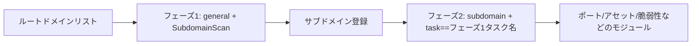

---

## name: scopesentry-mcp
description: ScopeSentry MCP を通じてセキュリティスキャンプラットフォーム（プロジェクト、タスク、テンプレート、アセット、ノード）を管理する。ユーザーが ScopeSentry、MCP、API Key、スキャンタスク、アセット照会に言及した場合に使用する。

# ScopeSentry MCP 使用ガイド

**ScopeSentry インスタンスを導入済み**のユーザー向け。Cursor（または他の MCP クライアント）からプラットフォームに接続し、ローカルソースコードは不要。

## 1. 準備

### 1.1 サービスのアクセス確認

- デフォルト Web インターフェース：`http://<ホスト>`
- MCP エンドポイント：`http://<ホスト>/mcp`（前方にリバースプロキシやフロントエンドプロキシがある場合は、実際の `/mcp` アドレスに従う）

### 1.2 API Key の作成

1. ブラウザで ScopeSentry Web インターフェースにログインする
2. **API Key** 管理ページで鍵を作成する（または管理者が提供する API から作成する）
3. 返される `ssk_...` 文字列を保存する（**一度だけ表示される**）

### 1.3 Cursor MCP の設定

Cursor → Settings → MCP → サーバーを追加：

```json
{
  "mcpServers": {
    "scopesentry": {
      "url": "http://<あなたのホスト>:8082/mcp",
      "headers": {
        "X-API-Key": "ssk_あなたの鍵"
      }
    }
  }
}
```

次も使用できる：`Authorization: Bearer ssk_あなたの鍵`

設定完了後、MCP を再起動するか Cursor を再読み込みし、ツールリストに `list_projects`、`list_assets` などが表示されることを確認する。

---

## 2. ツール一覧


| ツール                     | 用途                |
| ---------------------- | ----------------- |
| `list_projects`        | タグごとにグループ化されたプロジェクトツリー（プロジェクト ID を含む） |
| `list_projects_data`   | ページングされたプロジェクトリスト。名前で検索可能     |
| `get_project`          | プロジェクトの詳細              |
| `create_project`       | プロジェクトを新規作成              |
| `list_tasks`           | スキャンタスクのリスト            |
| `get_task`             | タスクの詳細              |
| `list_scan_templates`  | スキャンテンプレートのリスト            |
| `get_scan_template`    | テンプレートの詳細              |
| `list_plugin_modules`  | スキャンパイプラインのモジュール名          |
| `list_plugins`         | 使用可能なプラグイン（hash、デフォルトパラメータを含む） |
| `create_scan_template` | スキャンテンプレートを作成            |
| `create_scan_task`     | スキャンタスクを作成            |
| `list_assets`          | 各種アセットを照会（ページングされたリスト）       |
| `count_assets`         | アセット数を集計（`/api/assets/common/total`） |
| `get_asset_detail`     | アセットまたは脆弱性の詳細           |
| `add_asset_tag`        | アセットにタグを追加           |
| `list_nodes`           | スキャンノードのリスト            |


各ツールのパラメータは MCP ツールの説明（schema）に従う。`list_assets` / `count_assets` の search、filter 構文は同一なので、アセットを照会する前に `list_assets` の description を先に読むとよい。

「合計件数」を知りたい場合は `count_assets`（Web のページング総数 API に相当）を使用し、総数を数えるために `list_assets` を繰り返しページ送りする必要はない。

---

## 3. よく使うワークフロー

### 3.1 プロジェクト単位でアセットを照会する

ユーザーまたはコンテキストに**すでにプロジェクト条件がある**場合は、`filter.project` を付けて範囲を絞り込み、プロジェクト横断のデータ過多によるレスポンス低下を避ける。明確なプロジェクトがない場合は、プロジェクトによる絞り込みを強制しなくてよい。

1. `list_projects` または `list_projects_data` で対象プロジェクトの **ObjectID**（`id` / `children[].value`）を取得する
2. `list_assets` に `filter.project` を渡す（**必ず ID。プロジェクトの表示名を書いてはいけない**）

```json
{
  "asset_type": "asset",
  "pageIndex": 1,
  "pageSize": 20,
  "search": "domain=^example.com",
  "filter": {
    "project": ["<プロジェクトObjectID>"]
  }
}
```

### 3.2 スキャンタスクの作成

1. `list_nodes` でオンラインのノード名を取得する
2. `list_scan_templates` または `create_scan_template` でテンプレートの **ObjectID** を取得する
3. `create_scan_task`：`name`、`node` は必須。`template` にはテンプレート ID を指定する（テンプレート名は指定できない）

**対象ソース `targetSource`（Web 側と同一）：**

| targetSource | 説明 | 必須パラメータ |
| --- | --- | --- |
| `general` | 対象を直接入力する | `target` |
| `project` | プロジェクトから対象を読み取る | `project`（プロジェクト ObjectID 配列） |
| `asset` | Web のアセットライブラリから検索する | `search`；オプション `project`、`filter`、`targetNumber` |
| `RootDomain` | ルートドメインライブラリから検索する | `search`；オプション `project`、`filter`、`targetNumber` |
| `subdomain` | サブドメインライブラリから検索する | `search`；オプション `project`、`filter`、`targetNumber` |
| `UrlScan` | URL スキャン結果から検索する | `search`；オプション `project`、`filter`、`targetNumber` |
| `*Source`（例：`subdomainSource`） | アセットページの「選択/検索」から作成する | `targetTp=search` の場合は `search`；`targetTp=select` の場合は `targetIds` |

**例 — ルートドメインを直接スキャンする：**

```json
{
  "name": "example-サブドメイン収集",
  "node": ["node-1"],
  "template": "<テンプレートObjectID>",
  "targetSource": "general",
  "target": "example.com\nfoo.com",
  "project": ["<プロジェクトObjectID>"]
}
```

**例 — サブドメインライブラリから継続スキャンする（前のタスク名で絞り込む）：**

```json
{
  "name": "example-ポートと脆弱性",
  "node": ["node-1"],
  "template": "<後続モジュールテンプレートObjectID>",
  "targetSource": "subdomain",
  "search": "task==\"example-サブドメイン収集\"",
  "project": ["<プロジェクトObjectID>"]
}
```

### 3.3 ルートドメインの完全な情報収集（2 フェーズを推奨）

入力が**ルートドメイン**で**完全な情報収集**を行う場合は、2 回に分けてスキャンし、1 回で全パイプラインを実行しないことを推奨する。

**理由：** 分散タスクは**単一の対象**単位で分配される。ルートドメインを対象とした場合、あるノードにそのルートドメインが割り当てられると、そのノードでスキャンされたサブドメインも同じノードで後続モジュールが実行され続けるため、負荷の偏り・速度低下・エラー発生を招きやすい。

**ベストプラクティス：**

1. **フェーズ 1 — サブドメイン収集のみ**
   - `targetSource`: `general`
   - `target`: すべてのルートドメイン（複数行）
   - テンプレート：`SubdomainScan`、`SubdomainSecurity`（サブドメインスキャン + サブドメイン乗っ取り）のみ有効化
   - `get_task` でタスクの完了を待つ

2. **フェーズ 2 — 後続モジュール**
   - `targetSource`: `subdomain`
   - `search`: `task=="<フェーズ1のタスク名>"`（タスク名を完全一致）
   - オプションで `project` を付けて範囲を絞り込む
   - テンプレート：ポートスキャン、アセット調査、脆弱性スキャンなど（SubdomainScan を含めなくてもよい）
   - サブドメインを独立した対象として各ノードに分配し、並列処理の効率を高める

Web インターフェースの「サブドメイン」アセットページでタスク名により絞り込んだ後、「サブドメインからタスクを作成」を使用しても同じ効果が得られる。



### 3.4 スキャンテンプレートの作成

1. `list_plugin_modules` → モジュール名のリスト
2. `list_plugins`（`module` で絞り込み可能）→ 各プラグインの `hash` とデフォルト `parameter`
3. `create_scan_template`：`modules` で「モジュール → プラグイン hash 配列」を指定する

---

## 4. アセット照会（`list_assets` / `count_assets`）

`count_assets` と `list_assets` は同じ `asset_type`、`search`、`filter` を使用し、`{ "total": N }` を返す。Web 側の `/api/assets/common/total` に対応する。

```json
{
  "asset_type": "subdomain",
  "search": "task==\"あるタスク名\"",
  "filter": {"project": ["<プロジェクトObjectID>"]}
}
```

**パフォーマンスの推奨（`list_assets` / `count_assets` 共通）：** プロジェクト条件がある場合は `filter.project` で範囲を絞り込むことを優先する。`search` ではインデックス作成済みフィールドに対して、できるだけ `==` の全等または `^` のプレフィックス一致（[4.3](#43-search-検索式) 参照）を使用し、広範囲の `=` による曖昧照会でレスポンスが遅くなるのを避ける。プロジェクトのコンテキストがない場合は絞り込みを強制しない。

`filter.project` をサポートする種別は [4.4](#44-filter-完全一致絞り込み) のテーブルを参照。

### 4.1 アセット種別 `asset_type`

`asset`、`RootDomain`、`subdomain`、`app`、`mp`、`UrlScan`、`SensitiveResult`、`DirScanResult`、`crawler`、`vulnerability`、`PageMonitoring`、`IPAsset`、`SubdomainTakerResult`

エイリアスの例：`web`→asset、`vuln`→vulnerability、`ip`→IPAsset、`url`→UrlScan

### 4.2 パラメータの説明


| パラメータ                       | 説明                                      |
| ------------------------ | --------------------------------------- |
| `pageIndex` / `pageSize` | ページング。デフォルト 1 / 20                            |
| `search`                 | 検索式（次節を参照）                              |
| `filter`                 | 完全一致絞り込み JSON（次節を参照）                          |
| `sort`                   | UrlScan、DirScanResult のみ `length` による並べ替えをサポート |
| `sid`                    | SensitiveResult のみ：機密ルール名                |


`search` と `filter` は**同時に使用できる**。

### 4.3 search 検索式

カスタム DSL（**SQL ではない**）：


| 演算子  | 意味   | インデックス | 例                          |
| ---- | ---- | ---- | --------------------------- |
| `=`  | 曖昧一致（regex） | インデックス不使用 | `domain=example`            |
| `==` | 完全一致（全等） | **インデックス使用** | `port==443`                 |
| `!=` | 除外   | — | `port!="80"`                |
| `&&` | AND    | — | `domain==example.com && port==443` |
| `||` | OR    | — | `title=admin || body=login` |


**インデックスと演算子：** `domain`、`ip`、`port`、`title` などのフィールドにはインデックスが作成されているが、**`==` の全等** または **値が `^` で始まるプレフィックス一致**（例：`domain=^example.com`）のみがインデックスを使用できる。**`=` は regex の曖昧一致に変換され、インデックスを使用できない**ため、データ量が多いと遅くなりやすい。

**全種別で共通の search フィールド：** `tag`、`task`（タスク名）、`rootDomain`

**project を search 内に書いてはいけない**（無効になるか、`&&` と組み合わせた場合にエラーになる）。プロジェクトで絞り込むには `filter.project` を使用する。

**種別ごとのよく使う search フィールド：**


| asset_type           | フィールド                                                                                  |
| -------------------- | ----------------------------------------------------------------------------------- |
| asset                | domain, ip, port, service, app, title, statuscode, icon, banner, type, body, header |
| RootDomain           | domain, icp, company                                                                |
| subdomain            | domain, ip, type, value                                                             |
| app                  | name, icp, company, category, description, url, apk                                 |
| mp                   | name, icp, company, category, description, url                                      |
| UrlScan              | url, input, source, resultId, type                                                  |
| SensitiveResult      | url, sname, body, info, md5                                                         |
| DirScanResult        | url, statuscode, redirect, length                                                   |
| vulnerability        | url, vulname, matched, request, response, level                                     |
| crawler              | url, method, body, resultId                                                         |
| PageMonitoring       | url, hash, diff, response                                                           |
| IPAsset              | ip, domain, port, service, webServer, app                                           |
| SubdomainTakerResult | domain, value, type, response                                                       |


**search の例：**

- `domain==www.example.com && port==443`（全等、インデックス使用）
- `domain=^example.com`（プレフィックス一致、インデックス使用）
- `ip==192.168.1.1`
- `task=="あるタスク名"`
- `level==high`（vulnerability）
- `statuscode==200`（DirScanResult）

曖昧な部分一致が必要な場合のみ `=` を使用する。例：`title=admin`（インデックス不使用。プロジェクトなどの条件と組み合わせて範囲を絞り込むのが望ましい）。

### 4.4 filter 完全一致絞り込み

JSON オブジェクト：同じ key の複数の値は **OR**、異なる key は **AND**。

**プロジェクト条件がある場合は `project` を優先する：** ユーザーまたはコンテキストでプロジェクトが明確で、asset_type が `project` をサポートする場合は、範囲を絞り込むために付与する。プロジェクト情報がない場合は強制しない。


| filter key   | 意味       | 値の説明                                                     |
| ------------ | -------- | -------------------------------------------------------- |
| `project`    | 所属プロジェクト     | **ObjectID**。`list_projects` / `list_projects_data` で取得 |
| `task`       | 取得元タスク     | **タスク名**。`list_tasks` の `name` を使用                         |
| `port`       | ポート       | 例：`"443"`                                                |
| `service`    | サービス/プロトコル    | 例：`"https"`                                              |
| `app`        | アプリフィンガープリント     | 例：`"Nginx"`                                              |
| `icon`       | アイコン hash  |                                                          |
| `statuscode` | HTTP ステータスコード | 主に asset で使用                                               |
| `status`     | 状態       | UrlScan/DirScan の HTTP コード；脆弱性/機密情報の処理状態                       |
| `level`      | 脆弱性レベル     | critical / high / medium / low / info                    |
| `type`       | 種別       | 例：サブドメインレコード種別 A、CNAME                                         |
| `color`      | 機密ルールの色   | SensitiveResult                                          |
| `sname`      | 機密ルール名    | SensitiveResult                                          |
| `tags`       | タグ       |                                                          |


**種別ごとの使用可能な filter key：**


| asset_type                            | filter key                                                      |
| ------------------------------------- | --------------------------------------------------------------- |
| asset                                 | project, port, service, app, icon, statuscode, type, task, tags |
| RootDomain                            | project, tags                                                   |
| subdomain                             | project, type, task, tags                                       |
| app / mp                              | project, tags                                                   |
| UrlScan                               | status, tags                                                    |
| DirScanResult                         | status, tags                                                    |
| SensitiveResult                       | status, color, sname, tags                                      |
| crawler                               | project, task, tags                                             |
| vulnerability                         | project, level, status, task, tags                              |
| PageMonitoring / SubdomainTakerResult | tags                                                            |
| IPAsset                               | project, port, service, app                                     |


**filter の例：**

```json
{"project": ["<プロジェクトObjectID>"], "port": ["443"]}
```

**組み合わせ照会の例：**

```json
{
  "asset_type": "asset",
  "search": "domain=^baidu && port==443",
  "filter": {"project": ["<プロジェクトObjectID>"]},
  "pageIndex": 1,
  "pageSize": 10
}
```

**注意：**

- プロジェクト条件がある場合は `filter.project` を優先して付与する（サポートされる場合）。プロジェクトのコンテキストがない場合は強制しなくてよい
- `filter.project` にプロジェクトの表示名を入れない
- 既知の値は `==`、プレフィックスは `^` を使用する。大きなテーブルに対する `=` の曖昧一致の乱用を避ける
- UrlScan の HTTP 状態は `filter.status` を使用する。DirScanResult は search 内で `statuscode==200` を使用できる
- SensitiveResult をルール名で絞り込む場合：`search` では `sname=ルール名`、または `filter.sname`

### 4.5 並べ替え sort

**UrlScan**、**DirScanResult** のみサポート：

```json
{"length": "ascending"}
```

他の種別は `sort` を無視し、時間順でデフォルトの並べ替えが行われる。

---

## 5. スキャンテンプレートのモジュール名

`TargetHandler`、`SubdomainScan`、`SubdomainSecurity`、`PortScanPreparation`、`PortScan`、`PortFingerprint`、`AssetMapping`、`AssetHandle`、`URLScan`、`WebCrawler`、`URLSecurity`、`DirScan`、`VulnerabilityScan`、`PassiveScan`

---

## 6. トラブルシューティング


| 現象        | 対処                                                 |
| --------- | -------------------------------------------------- |
| MCP にツールがない   | URL、API Key、ScopeSentry が実行中かを確認する                    |
| 401 / 403 | API Key を作成し直すか変更する                                    |
| アセットが見つからない     | `filter.project` が ObjectID であることを確認する。search に project を書かない |
| テンプレート/タスクの作成に失敗 | `template` はテンプレート ObjectID である必要がある。`node` にはオンラインのノード名を指定する            |
| 照会が遅い/固まる   | プロジェクトがある場合は `filter.project` を追加する。search ではインデックス作成済みフィールドを `==` または `^` プレフィックスに変更し、`=` の使用を減らす。`pageSize` を小さくする |


---

